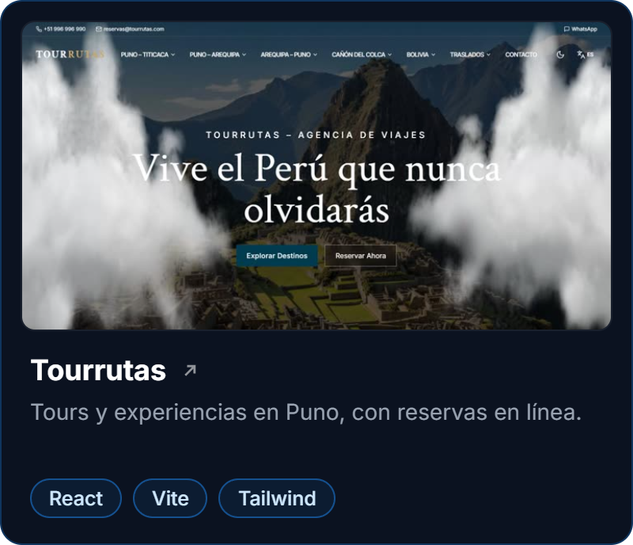
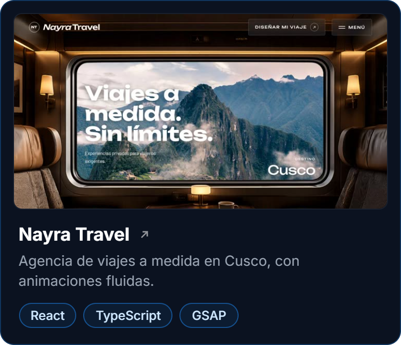
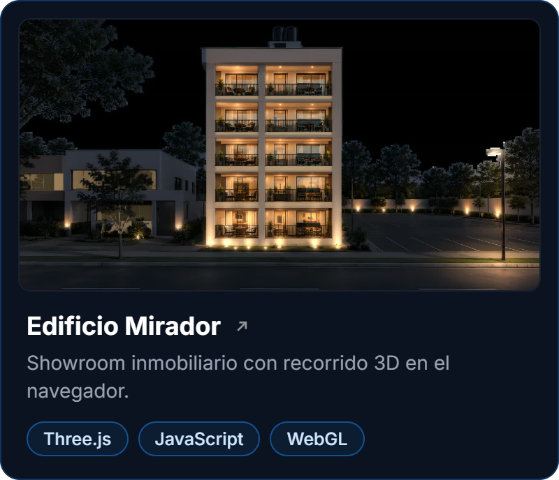

  

<h3>&nbsp; Sobre mí</h3>

Desarrollador Full-Stack apasionado por crear soluciones web modernas, eficientes y escalables.
Me gusta llevar las ideas a productos reales: webs rápidas, sistemas a medida e IA aplicada.

<h3>&nbsp; Stack</h3>

<h3>&nbsp; Proyectos destacados</h3>

  
  
  

<h3>&nbsp; Actividad en GitHub</h3>

  

<picture>
  <source media="(prefers-color-scheme: dark)" srcset="https://raw.githubusercontent.com/CatLon-dev/CatLon-dev/output/contribuciones-oscuro.svg" />
  <source media="(prefers-color-scheme: light)" srcset="https://raw.githubusercontent.com/CatLon-dev/CatLon-dev/output/contribuciones.svg" />
  
</picture>

 

<a href="https://github.com/CatLon-dev"> construyendo algo mejor cada día" /></a>
