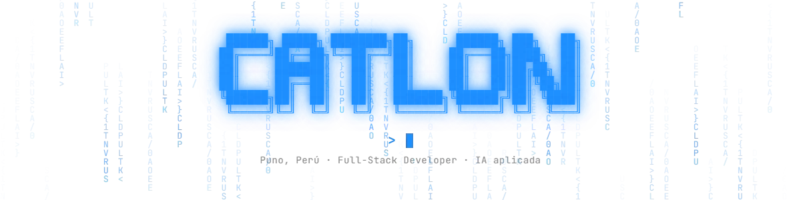
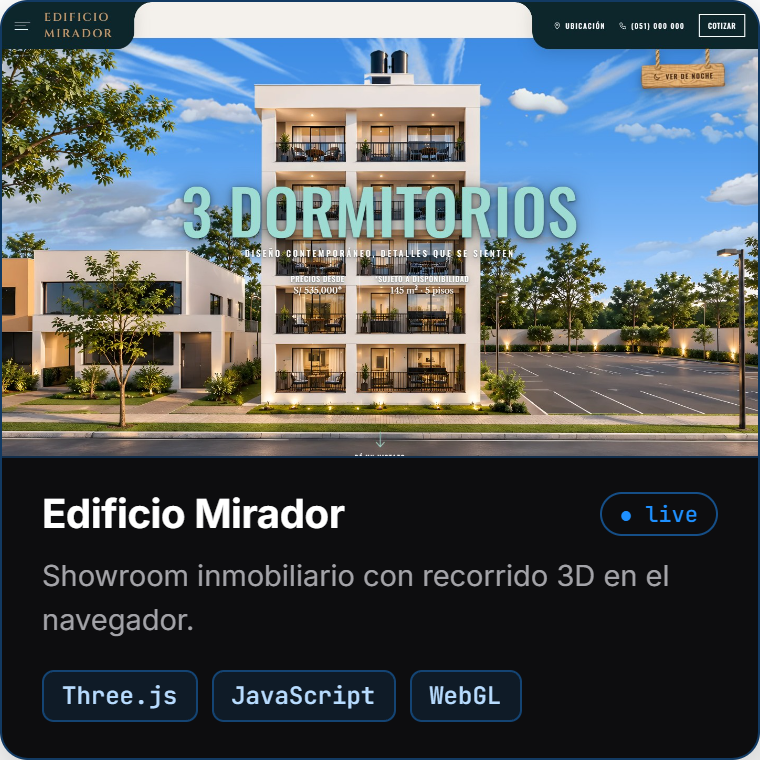
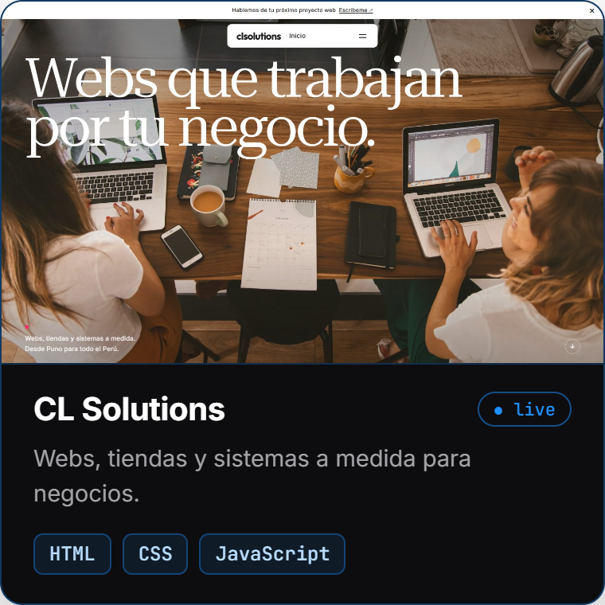
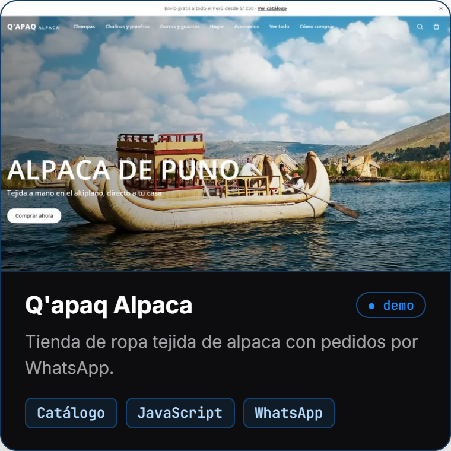

  

<h3>&nbsp; Sobre mí</h3>

Hola 👋, soy **Brayan Checalla**, desarrollador Full-Stack de Puno, Perú.
Construyo soluciones web escalables, sistemas a medida e integro Inteligencia Artificial en productos reales.
Me gusta el código limpio, mantenible y eficiente.

  
  
  

<h3>&nbsp; Stack</h3>

<h3>&nbsp; Proyectos destacados</h3>

  
  
  

<h3>&nbsp; Actividad en GitHub</h3>

<picture>
  <source media="(prefers-color-scheme: dark)" srcset="https://streak-stats.demolab.com?user=CatLon-dev&locale=es&hide_border=true&border_radius=10&background=0D111700&ring=1E90FF&fire=1E90FF&currStreakNum=FFFFFF&sideNums=FFFFFF&currStreakLabel=1E90FF&sideLabels=8B949E&dates=8B949E&stroke=1E90FF40" />
  <source media="(prefers-color-scheme: light)" srcset="https://streak-stats.demolab.com?user=CatLon-dev&locale=es&hide_border=true&border_radius=10&background=FFFFFF00&ring=1E90FF&fire=1E90FF&currStreakNum=24292F&sideNums=24292F&currStreakLabel=1E90FF&sideLabels=57606A&dates=57606A&stroke=1E90FF40" />
  
</picture>

 

<a href="https://github.com/CatLon-dev"> construyendo algo mejor cada día" /></a>
